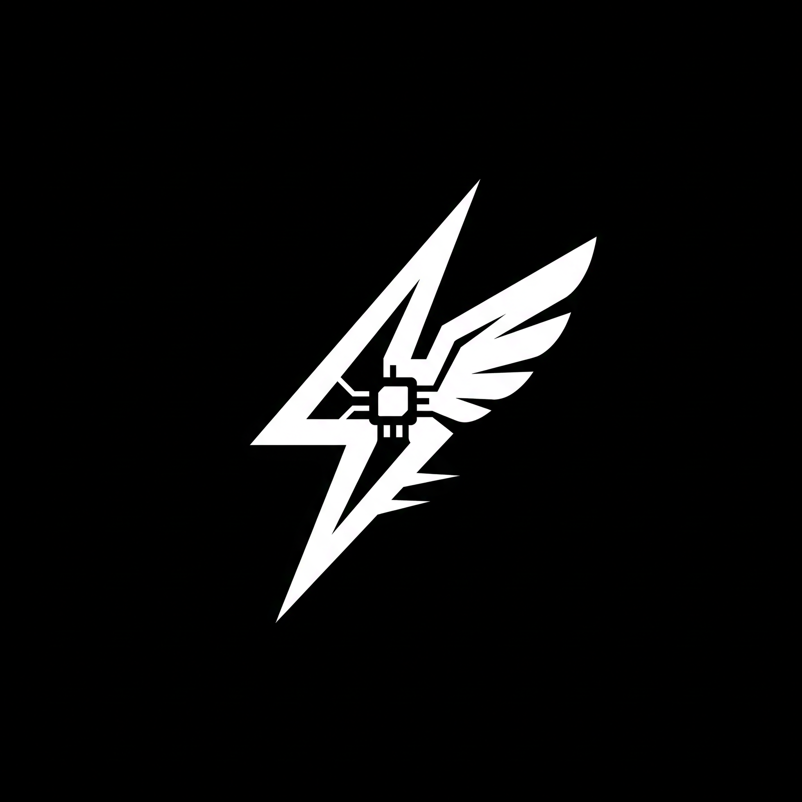

# Kaze-1B-A300M / Kaze-4.7B-A530M

<p align="center">
  
</p>

[](https://pytorch.org/)
[](./LICENSE)
[-2E7D32.svg?style=flat-square)](#despliegue-edge)
[](#exportación-a-gguf)
[](./HF_MODEL_CARD.md)

**Kaze-1B-A300M** (y su variante ajustada por instrucciones **Kaze-1B-A300M-Instruct**) es un modelo fundacional ligero de tipo *Sparse Mixture-of-Experts* (MoE) entrenado desde cero por **Kineyo** (`@kineyo.io` / `Dev_Kofu`). Diseñado para inferencia local de baja latencia en dispositivos edge (CPU x86_64/ARM64, Linux y Android sin GPU dedicada), combina ~1.02B de parámetros totales con ~315M de parámetros activos por token.

---

## Resumen de Arquitectura

Topología **DeepSeek-style MoE** con 1 experto compartido siempre activo y 7 expertos enrutados (activación Top-2 por token), balanceo de carga *Aux-Loss-Free* y atención GQA 3:1 para reducir un 66% el consumo de KV-cache.

| Hiperparámetro | Valor | Notas |
| :--- | :--- | :--- |
| `vocab_size` | `32768` | Byte-Level BPE propio (múltiplo de 128) |
| `d_model` | `768` | Dimensión oculta del Transformer |
| `n_layers` | `20` | Bloques Decoder-only con pre-norm `RMSNorm` |
| `n_heads` | `12` | Cabezas de Query (`head_dim = 64`) |
| `n_kv_heads` | `4` | Grouped-Query Attention (ratio 3:1) |
| `d_ff` | `2816` | Dimensión intermedia de cada experto `SwiGLU` |
| Topología MoE | `1 Shared + 7 Routed (Top-2)` | 3 expertos activos por token + *Aux-Loss-Free* |
| `max_seq_len` | `4096` | Posicional `RoPE` (`theta = 100000.0`) |
| Weight Tying | `True` | `tok_embeddings` compartido con `lm_head` |
| Precisión de entrenamiento | `bfloat16` | FlashAttention (`SDPA`) + `torch.compile` + WSD |

---

## Estructura del Repositorio

```text
kaze-1b-a300m/
├── LICENSE                     # Apache License 2.0 (Kineyo, 2026)
├── README.md                   # Documentación de ingeniería y entrenamiento
├── HF_MODEL_CARD.md            # Model Card lista para Hugging Face Hub
├── CONTRIBUTING.md             # Guía de contribuciones y PRs
├── SECURITY.md                 # Política de divulgación de vulnerabilidades
├── tokenizer/
│   └── train_tokenizer.py      # Entrenamiento Byte-Level BPE (32,768 tokens)
├── model/
│   └── kaze_moe.py             # Arquitectura KazeMoEModel (DeepSeek-style MoE + GQA)
├── train/
│   └── pretrain.py             # Pre-entrenamiento PyTorch BF16 + WSD + safetensors
├── export/
│   └── export_gguf.py          # Exportación de .safetensors a GGUF (Q4_K_M / IQ4_XS / Q8_0)
└── scripts/
    └── prepare_data.py         # Tokenización en streaming a /dev/shm en formato uint16
```

---

## Guía Rápida (Quickstart)

### 1. Requisitos

```bash
pip install torch datasets tokenizers safetensors numpy
```

### 2. Entrenar el tokenizador Byte-Level BPE (`32,768` tokens)

```bash
python tokenizer/train_tokenizer.py \
  --dataset latam-gpt/LatamGPT-Corpus-1.0 \
  --vocab-size 32768 \
  --max-docs 50000 \
  --output-dir tokenizer/artifacts
```

### 3. Preparar datos binarios en `/dev/shm` (`uint16`)

Almacenar los shards tokenizados en `/dev/shm` elimina el cuello de botella de I/O en disco durante el pre-entrenamiento.

```bash
python scripts/prepare_data.py \
  --dataset latam-gpt/LatamGPT-Corpus-1.0 \
  --tokenizer tokenizer/artifacts/tokenizer.json \
  --output-dir /dev/shm/kaze_data \
  --max-docs 200000 \
  --val-ratio 0.01
```

### 4. Pre-entrenamiento con Scheduler WSD (NVIDIA A100 / L4)

```bash
python train/pretrain.py \
  --data-dir /dev/shm/kaze_data \
  --output-dir checkpoints/kaze-1b-a300m \
  --seq-len 2048 \
  --micro-batch 8 \
  --grad-accum 8 \
  --max-steps 50000 \
  --warmup-steps 1000 \
  --decay-steps 5000 \
  --max-lr 3e-4 \
  --min-lr 3e-5 \
  --compile
```

Para GPUs de menor VRAM (por ejemplo, NVIDIA L4 24GB en Colab), activar `--grad-checkpoint` y reducir `--seq-len 512 --micro-batch 4`.

### 5. Exportación a GGUF

```bash
python export/export_gguf.py \
  --checkpoint checkpoints/kaze-1b-a300m/kaze_1b_a300m.safetensors \
  --config checkpoints/kaze-1b-a300m/config.json \
  --tokenizer tokenizer/artifacts/tokenizer.json \
  --output-dir export/out \
  --quantize Q4_K_M IQ4_XS Q8_0
```

---

## Ecosistema

`Kaze-1B-A300M` sirve como el motor neuronal local principal para el ecosistema **Proyecto Kofu** y **Hada**, proporcionando inferencia privada, determinista y de bajo consumo en hardware personal y dispositivos móviles mediante `llama.cpp` y `LiteRT`.

---

## Licencia

Distribuido bajo la licencia **Apache License 2.0**. Consulta [LICENSE](./LICENSE) para más detalles.
