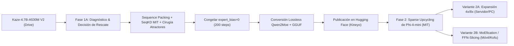

# Plan Maestro: Rescate de Kaze Puro (Hugging Face) + Sparse Upcycling de Phi-4-mini (MIT)

## Goal Description

Este plan divide el trabajo en **dos fases ordenadas**:

1. **Fase 1 (Prioridad inmediata — Rescate de Kaze Puro):** Convertir el checkpoint actual de **`Kaze-4.7B-A530M`** (100% entrenado desde cero, licencia MIT) en un modelo **funcional, estable, sin atractores de memorización y listo para publicar en Hugging Face** (en formato `Qwen2MoeForCausalLM` + `GGUF` compatible con `llama.cpp`), maximizando lo que se puede lograr en Colab (L4/A100).
2. **Fase 2 (Siguiente etapa — Sparse Upcycling de `Phi-4-mini`, licencia MIT):** Documentar y ejecutar el plan para transformar **`microsoft/Phi-4-mini-instruct`** (3.8B, licencia MIT) en una arquitectura **MoE Kaze** que conserve la coherencia e inteligencia de un modelo pre-entrenado con trillones de tokens sin caer en olvido catastrófico.



---

## User Review Required

> [!IMPORTANT]
> **Decisión clave para Fase 1 (Rescate de Kaze Puro):**
> En `Kaze-4.7B-A530M` hay **31 expertos enrutados** (`top_k=2`), por lo que cada experto solo recibe el **6.4%** de los tokens entrenados. Con presupuesto de Colab, tienes dos formas de rescatarlo:
> - **Ruta 1A (Recomendada para máxima coherencia en Colab):** Podar/consolidar primero con [prune_to_aura_kaze_go.py](file:///home/alex/Documentos/kaze-1b-a300m/export/prune_to_aura_kaze_go.py) de `31 → 7 expertos` (**`Kaze-1.2B-A530M`**) y luego aplicar el rescate (SeqKD + Sequence Packing). Cada experto recibe **4.4× más gradientes**, el entrenamiento corre **~3× más rápido** y pesa `~750 MB` en `Q4_K_M`.
> - **Ruta 1B (Mantener los 4.7B completos):** Rescatar directamente `Kaze-4.7B-A530M` (31 expertos) usando Sequence Packing + SeqKD bilingüe + cirugía de atractores. Tarda más por época y cada experto ve menos tokens, pero conserva el tamaño `4.7B-A530M`.

> [!WARNING]
> **Expectativa realista en Fase 1:** Incluso rescatado al máximo en Colab (decenas/cientos de millones de tokens adicionales), Kaze puro entrenado desde cero será un modelo **experimental / fundacional ligero en español** con buena estabilidad de formato, identidad y tareas acotadas, pero **no** tendrá la amplitud enciclopédica ni el razonamiento profundo de un modelo pre-entrenado con trillones de tokens (eso se logra en la **Fase 2**). La Model Card en Hugging Face reflejará sus métricas y límites con total honestidad.

---

## Decisiones Confirmadas por el Usuario

1. **Fase 1 (Rescate):** Rescatar **`Kaze-4.7B-A530M`** completo (31 expertos enrutados + 1 compartido) usando entrenamiento de alta eficiencia en L4 (LoRA de alto rango `r=32` fusionado *lossless* a pesos crudos + consolidación `expert_bias=0` + *Sequence Packing* + datos anti-atractores y aritmética verificada).
2. **Publicación Hugging Face:** Repositorio **`Kineyo/Kaze-4.7B-A530M-MIT`**, licencia **MIT**, subiendo **pesos en crudo divididos (*sharded safetensors*)** + cuantización **`Q4_K_M` (GGUF)**.
3. **Fase 2 (Siguiente etapa):** **Variante 2B** (*MoEfication / FFN-Slicing* sobre `Phi-4-mini` MIT) integrada con arquitectura de parámetros **Hot / Warm / Cold** y carga directa desde almacenamiento **UFS** para `Kofu_Mobile`:
   - **Hot (RAM/VRAM residente):** Embeddings, Atención GQA, Router y *Shared Expert* (acceso constante por token).
   - **Warm (Caché LRU en RAM):** Los expertos enrutados más activos de la conversación actual.
   - **Cold (Streaming directo desde UFS vía `mmap` / `pread`):** Expertos enrutados de baja frecuencia, cargados bajo demanda aprovechando el ancho de banda secuencial de UFS 3.1/4.0.

---

## Proposed Changes

### Fase 1: Rescate Integral de Kaze Puro y Publicación en Hugging Face

#### 1.1 Diagnóstico y Destrucción de Atractores (Cirugía de Datos + SeqKD MIT)
El problema principal detectado en V2 fue:
- **Atractor fuerte en `"Escribe una función en Python..."`** → devuelve `def es_primo` sin importar la instrucción (#8).
- **Desperdicio de ~60% del cómputo en `<|pad|>`** durante el entrenamiento V2.
- **Poca diversidad de español instructivo + aritmética simbólica verificada.**

Para rescatarlo sin romper la pureza 100% desde cero:
1. **Sequence-Level Knowledge Distillation (SeqKD) 100% MIT:**
   - Generar/curar un corpus sintético limpio en español e inglés (~15,000–30,000 ejemplos de alta calidad, sin ruido) usando `Phi-4-mini` (MIT) o datasets MIT curados (`FineWeb-Edu` / `Cosmopedia` / `Magicoder` filtrado + traducciones limpias al español):
     - **2,000+ funciones Python distintas en español** (todas con prefijos variados incluyendo `"Escribe una función en Python que..."`: invertir cadena, factorial, palíndromo, fibonacci, burbuja, contar vocales, etc.) para **eliminar por completo el atractor de `es_primo`**.
     - **5,000+ problemas de aritmética paso a paso verificados con Python** (sumas, restas, multiplicaciones, porcentajes y presupuestos con respuestas 100% exactas).
     - **5,000+ preguntas de conocimiento general, ciencia, historia y finanzas personales en español** (respuestas claras de 2–4 párrafos para recuperar generación larga y coherente).
     - **Identidad Kaze < 1%** para evitar memorización.
2. **Sequence Packing (0% desperdicio en `<|pad|>`):**
   - Empaquetar múltiples conversaciones separadas por `<|endoftext|>` en secuencias densas de `512` o `1024` tokens, aplicando `loss_mask` únicamente sobre los tokens de `<|assistant|>` y `<|endoftext|>`.
   - Multiplica el número real de tokens entrenados por hora en **~2.5×–3×**.
3. **Optimización de Entrenamiento en Colab (L4/A100):**
   - `AdamW8bit` + `bfloat16` + `gradient_checkpointing` + *Cosine LR* suave (`3e-5 → 3e-6`) + *weight decay* `0.05` + evaluación periódica sobre un **validation set estrictamente no visto** (incluyendo métricas en las preguntas nuevas #7, #8, #9 y prompts en inglés).
4. **Estabilización de Routing para Exportación Lossless (`expert_bias = 0`):**
   - En los últimos **200 pasos**, congelar `expert_bias` a `0` (`bias_update_speed = 0.0`, `expert_bias.zero_()`).
   - Esto elimina la advertencia de [convert_kaze_to_qwen2moe.py](file:///home/alex/Documentos/kaze-1b-a300m/export/convert_kaze_to_qwen2moe.py#L124-L128) y garantiza que `Qwen2MoeForCausalLM` y `llama.cpp` reproduzcan exactamente los mismos logits que PyTorch.

---

#### 1.2 Scripts de Rescate y Empaquetado para Hugging Face

##### [NEW] `train/rescue_kaze.py`
Script autocontenido (ejecutable en Colab y local) que implementa:
- Carga zero-copy desde checkpoint `safetensors` (`4.7B` o `1.2B` podado).
- Generación/carga de dataset anti-atractores + aritmética verificada + SeqKD MIT.
- *Sequence Packing* sin padding + *Cosine LR* + *Early Stopping* por `val_loss`.
- Fase final de consolidación con `expert_bias = 0` para exportación lossless.

##### [MODIFY] [convert_kaze_to_qwen2moe.py](file:///home/alex/Documentos/kaze-1b-a300m/export/convert_kaze_to_qwen2moe.py)
- Asegurar consistencia entre los tokens especiales entrenados (`<|user|>`, `<|assistant|>`, `<|endoftext|>`, `<|pad|>`) y el `chat_template` de `tokenizer_config.json` (actualmente el script exporta ChatML `<|im_start|>`, mientras Kaze fue entrenado con `<|user|>\n...\n<|assistant|>\n...<|endoftext|>`). **Corregir este desajuste es crítico** para que el modelo funcione bien al cargarlo desde Hugging Face o `llama.cpp`!
- Añadir verificación numérica automática (`max_abs_diff < 1e-2` entre `KazeMoEModel` y `Qwen2MoeForCausalLM` sobre un prompt de prueba).

##### [MODIFY] [HF_MODEL_CARD.md](file:///home/alex/Documentos/kaze-1b-a300m/HF_MODEL_CARD.md)
- Actualizar arquitectura, parámetros exactos, licencia unificada, ejemplos de uso con `transformers` (`AutoModelForCausalLM` usando `Qwen2MoeForCausalLM` nativo sin `trust_remote_code`!), tabla de cuantizaciones GGUF y resultados reales y verificables de las pruebas de evaluación.

##### [NEW] `scripts/upload_to_hf.py`
- Sube el bundle validado (`model.safetensors`, `config.json`, `tokenizer.json`, `tokenizer_config.json`, `README.md`, y opcionalmente `*.gguf`) al repositorio de Hugging Face mediante `huggingface_hub.HfApi.upload_folder`.

---

### Fase 2 (Plan Anotado): Sparse Upcycling de `Phi-4-mini` (MIT) → `Kaze-Phi-MoE`

Esta fase se ejecutará **después** de estabilizar y subir Kaze puro. Aprovecha `microsoft/Phi-4-mini-instruct` (3.8B, **licencia MIT**, pre-entrenado con trillones de tokens) para construir un **MoE de grado producción** sin partir de cero ni sufrir olvido catastrófico.

#### Arquitectura Base (`Phi-4-mini-instruct`)
- `32` capas Transformer, `hidden_size = 3072`, `intermediate_size = 8192` (`SwiGLU`), GQA `24Q / 8KV`, `vocab_size = 200,064`, contexto `128K`, licencia **MIT**.

#### Dos Variantes de Upcycling

| Aspecto | **Variante 2A: Expansión MoE (4× o 8×)** | **Variante 2B: MoEfication / FFN-Slicing (Edge/Móvil)** |
|---|---|---|
| **Mecánica** | Clona la FFN (`8192`) en `4` u `8` expertos + perturbación $\sigma=10^{-3}$ + router `top_k=2` + 1 *Shared Expert* | Agrupa por clustering las `8192` neuronas FFN en `1 Shared (2048)` + `7 Routed (1024)` con `top_k=2` |
| **Parámetros totales / activos** | `~8.5B–14B` totales / `~3.8B–4.2B` activos | **`~3.8B` totales / `~1.8B` activos** |
| **Peso en `Q4_K_M` GGUF** | ~5.0 – 8.0 GB (PC / Servidor) | **~2.2 GB (ideal para `Kofu_Mobile`)** |
| **Ventaja clave** | Aumenta la capacidad de conocimiento por dominio (ES, finanzas, código) | **~1.8× más rápido en Android** manteniendo la inteligencia de Phi-4-mini |

#### Pipeline Técnico de Fase 2 (3 Etapas Anti-Olvido Catastrófico)
1. **Etapa 2.1 — Construcción Lossless (Paso 0 idéntico a Phi-4-mini):**
   - Crear `scripts/upcycle_phi4_to_moe.py`.
   - En el paso 0, verificar que la salida del modelo MoE recién creado coincide con `Phi-4-mini` original (`KL-divergence ≈ 0`).
2. **Etapa 2.2 — Router Warmup + Especialización Controlada (Anti-Forgetting):**
   - Congelar atención y embeddings inicialmente; entrenar solo el **router + LoRA en expertos** (`lr = 5e-5`, *Aux-Loss-Free* load balancing) sobre mezcla balanceada:
     - 40% Español general / ciencia / historia (mantiene coherencia general)
     - 25% Finanzas personales / `Kofu_Mobile`
     - 20% Programación Python / Kotlin / C++
     - 15% Matemáticas paso a paso
   - Evaluar en las **13 pruebas + GSM8K/MMLU-mini** cada 250 pasos; activar *early stopping* si cualquier métrica base cae >1%.
3. **Etapa 2.3 — Fusión y Exportación a GGUF:**
   - Fusionar adaptadores (`merge_and_unload`), mapear a arquitectura soportada por `llama.cpp` (`Qwen2Moe` / `Mixtral` / `PhiMoe`), cuantizar a `Q4_K_M` y probar en `Kofu_Mobile` (`dev-test`).

---

## Verification Plan

### Automated Tests (Fase 1)
1. **Paridad numérica PyTorch vs Hugging Face (`Qwen2MoeForCausalLM`):**
   ```bash
   python3 export/convert_kaze_to_qwen2moe.py \
     --checkpoint /ruta/kaze_rescued.safetensors \
     --config /ruta/config.json \
     --tokenizer /ruta/tokenizer.json \
     --output-dir /ruta/hf_bundle \
     --verify
   ```
   - Criterio de aprobación: `max(|logits_kaze - logits_qwen2moe|) < 5e-2` en `bfloat16` y mismos tokens generados en greedy decoding (`temperature=0`).
2. **Batería de 13 Pruebas (9 ES + 4 EN) + Test Anti-Atractor:**
   - Verificar que `#8` (*"Escribe una función en Python que invierta una cadena de texto"*) **ya NO devuelve `def es_primo`** y produce código válido (`return s[::-1]`).
   - Verificar que `#4` (`3×12 - 8 = 28`) y `#9` (`4×10 - 5 = 35`) resuelvan correctamente la aritmética.
   - Verificar que `#7` (*presupuesto personal*) dé una respuesta coherente de >30 tokens.
3. **Validación de Carga HF + GGUF:**
   - Cargar el bundle con `transformers.AutoModelForCausalLM.from_pretrained(hf_dir)` y generar texto sin errores.
   - Convertir a `GGUF Q4_K_M` con `llama.cpp` y verificar inferencia limpia con `llama-cli`.

### Manual Verification
- Revisar cualitativamente las respuestas de las 13 pruebas antes de subir a Hugging Face.
- Confirmar la Model Card ([HF_MODEL_CARD.md](file:///home/alex/Documentos/kaze-1b-a300m/HF_MODEL_CARD.md)) y el nombre del repositorio destino antes de ejecutar `scripts/upload_to_hf.py`.
