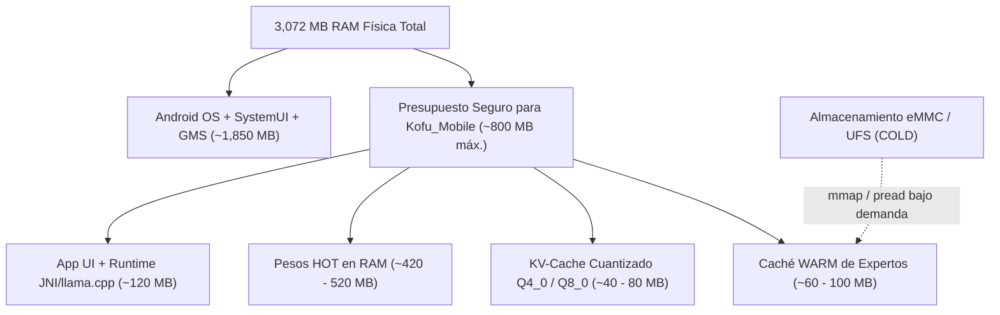

# Plan Técnico: IA Ultra-Ligera para Procesadores ARM Mali + 3 GB de RAM (`Kaze-Mali-3GB`)

## Goal Description

Diseñar y entrenar un modelo de lenguaje funcional, sin alucinaciones absurdas y estable para **smartphones Android de entrada (3 GB de RAM física + SoC MediaTek Helio / Exynos / Unisoc con GPU ARM Mali)** dentro de **`Kofu_Mobile`**.

### Restricción Física Real de un Teléfono de 3 GB de RAM
En Android con **3 GB de RAM totales**, el sistema operativo + servicios de Google + UI consumen entre **1.7 GB y 2.1 GB**. El *Low Memory Killer (LMK)* de Android termina cualquier app que supere **~750 MB – 1.0 GB de RSS real**.

> [!IMPORTANT]
> **Regla de Oro para 3 GB RAM + ARM Mali:**
> El archivo del modelo en cuantización **IQ4_XS / Q4_K_M** debe pesar **entre `350 MB` y `620 MB` máximo** (`~500M` a `~1.0B` parámetros totales, o un MoE compacto con `~350M–500M` activos), para garantizar **0 cierres por OOM/LMK** y **12–25 tok/s** reales.

---

## Arquitectura Recomendada (2 Niveles según Precisión vs Velocidad)

### Opción Principal (Recomendada): **`Kaze-Mali-0.5B-MoE`** (Basado en `Qwen2.5-0.5B-Instruct` Apache 2.0 + Sparse Upcycling sin pérdida)
- **Shared Backbone (HOT, congelado):** `Qwen2.5-0.5B-Instruct` (`494M` params → **`~315 MB` en `IQ4_XS`** / **`~380 MB` en `Q4_K_M`**).
- **Routed Domain Experts (WARM/COLD sobre almacenamiento):** `6` expertos enrutados ligeros (`bottleneck = 32`, `top_k = 2`) especializados en **finanzas `Kofu_Mobile`, español conversacional, aritmética y resúmenes** (`~12 MB` en `Q4`).
- **Consumo total real en Android:**
  - Pesos + expertos: **`~330 – 395 MB`**
  - KV-Cache (`ctx = 2048`, `Q8_0` KV): **`~35 MB`**
  - Runtime + App: **`~120 MB`**
  - **TOTAL RSS: `~485 – 550 MB`** → **100% seguro en 3 GB RAM** (margen de seguridad de >400 MB contra LMK).
- **Velocidad esperada en ARM Mali / CPU ARMv8.2-A:** **`18 – 35 tok/s`**.

### Opción Alternativa (Máxima Inteligencia en 3 GB RAM): **`Kaze-Mali-1B-IQ4`** (`Llama-3.2-1B` o `Qwen2.5-1.5B` en `IQ3_XXS`)
- Peso: **`~620 – 700 MB`** en `IQ4_XS` / `IQ3_XXS`.
- **TOTAL RSS:** `~780 – 880 MB` (justo en el límite de 3 GB RAM; requiere `ctx = 1024`, `KV = Q4_0` y liberar caché agresivamente con `onTrimMemory()`).

---

## Estrategia Específica para GPU ARM Mali (Sin Cuellos de Botella)

> [!WARNING]
> **Realidad de los drivers ARM Mali en gama baja (Mali-G52 / G57 / G68 / T830):**
> - **NO soportan CUDA ni OpenCL FP16 estable** en muchos kernels Android (drivers antiguos o fragmentados).
> - **Vulkan (`ggml-vulkan`)** funciona bien en **Mali-G57 / G68 / G77+ (Valhall)** con `VK_KHR_16bit_storage` y `VK_KHR_shader_float16_int8`, pero en **Mali-G52 / Bifrost antiguos** suele ser más lento o inestable que el CPU ARM64 con `NEON + dotprod`.

### Cascada de Hardware Automática para `Kofu_Mobile` (Mali + 3 GB RAM)
1. **Nivel 1 — Vulkan (`ggml-vulkan`) solo si Mali Valhall+ (`G57/G68/G77/G78/G610/G715`) y `>= 4 GB RAM`:**
   - Offload parcial (`n_gpu_layers = 8..16`) para evitar que Vulkan duplique buffers en RAM unificada (en móviles la VRAM **es** la misma RAM física de 3 GB!).
2. **Nivel 2 — CPU ARM64 `NEON + dotprod + fp16` (Default óptimo en 3 GB RAM + Mali):**
   - **Cero duplicación de memoria** entre CPU y GPU (crítico en 3 GB RAM).
   - Usar cuantizaciones alineadas a instrucciones ARM `SDOT` / `I8MM`: **`Q4_0` / `Q4_K_M` / `IQ4_NL`** (en CPU ARM64, `Q4_0` con `repack` / `KleidiAI` es hasta **2× más rápido** que `IQ3_XS`).
   - Fijar hilos a los núcleos **Big** únicamente (`n_threads = 2..4`, evitar los núcleos Little que causan *throttling* y *lock contention*).
3. **Nivel 3 — Memoria Virtual Segura (`mmap` + `mlock=false` + `KV Q8_0`):**
   - Activar `use_mmap = true`, `use_mlock = false` para que Android pueda paginar páginas frías desde eMMC/UFS sin matar la app.
   - Cuantizar el KV-cache (`type_k = Q8_0`, `type_v = Q8_0`, `n_ctx = 1536` o `2048`) reduciendo el uso de memoria de contexto a la mitad.
   - `FlashAttention` activado (`flash_attn = true`) para evitar picos $O(N^2)$ de memoria en prompts largos.

---

## Plan de Ejecución por Fases

### Fase M1 — Entrenamiento y Sparse Upcycling (`Kaze-Mali-0.5B-MoE`, ~15 min en Colab L4)
1. Cargar `Qwen2.5-0.5B-Instruct` (Apache 2.0) y correr el benchmark de **10 pruebas de presión** como línea base.
2. Aplicar **Sparse Upcycling sin pérdida** (`6` expertos enrutados `bottleneck=32`, `top_k=2`, `W_down=0` en paso 0) sobre mezcla limpia:
   - 45% Finanzas personales / `Kofu_Mobile` (presupuestos, ahorro, clasificación de gastos en JSON)
   - 30% Español general / ciencia / conversación corta (respuestas concisas <150 tokens ideales para móvil)
   - 25% Aritmética paso a paso + Python básico
3. **Opción de Fusión Directa (`Merge-to-Dense-GGUF`):** Para compatibilidad 100% inmediata con `llama.cpp` + `KleidiAI` en Mali/ARM64 sin escribir shaders nuevos, ofrecer dos exportaciones:
   - `kaze-mali-0.5b-q4_0.gguf` (`~320 MB`, máxima velocidad ARM KleidiAI / NEON)
   - `kaze-mali-0.5b-q4_k_m.gguf` (`~380 MB`, mejor precisión)
   - + paquete modular de expertos `kaze-mali-0.5b-moe-experts.safetensors` (`~24 MB` BF16 / `~6 MB` Q4) para el motor Hot/Warm/Cold.

### Fase M2 — Optimización en `Kofu_Mobile` (`dev-test`)
1. Añadir perfil `TierMali3GB` en el detector de hardware de `Kofu_Mobile`:
   - Si `totalRamMB <= 3500` o GPU contiene `"Mali-G52"` / `"Mali-T"` / `"Mali-G31"`:
     - Seleccionar automáticamente `kaze-mali-0.5b-q4_0.gguf` (`~320 MB`).
     - Forzar `n_gpu_layers = 0` (CPU ARM64 NEON/KleidiAI para evitar duplicación de RAM en Vulkan).
     - Fijar `n_ctx = 1536`, `kv_cache = Q8_0`, `flash_attn = true`, `n_threads = min(4, big_cores)`.
2. Conectar `ComponentCallbacks2.onTrimMemory(TRIM_MEMORY_RUNNING_LOW)` para liberar caché Warm y reducir `n_ctx` dinámicamente antes de que Android LMK cierre la app.

---

## Verification Plan

### Pruebas Automatizadas (Colab + Android)
1. **Stress Test de Precisión (`Kaze-Mali-0.5B-MoE`):** Correr la misma batería de 10 pruebas (aritmética, finanzas Kofu, código Python con `assert` y aguja en pajar a `1,536` tokens) y validar **≥ 7/10** en un modelo de apenas `~350 MB`.
2. **Perfilado de RAM Real (`llama-cli` / Android Profiler):**
   - Medir `PSS` / `RSS` máximo en inferencia con `n_ctx = 1536` y `Q4_0` / `Q4_K_M`.
   - Criterio de aprobación: **RSS pico < `600 MB`** y velocidad **≥ `15 tok/s`** en CPU ARM64 de gama baja.
3. **Prueba de Estabilidad Térmica / LMK:** 20 turnos consecutivos en un dispositivo o emulador AVD configurado con **3,072 MB de RAM** verificando **0 crashes por OOM**.

---

## Open Questions

1. Para **`Kaze-Mali-3GB`**, ¿prefieres arrancar con **`Qwen2.5-0.5B-Instruct` (`~350 MB`, ultra-seguro en 3 GB RAM)** o probar **`Qwen2.5-1.5B` en `IQ3_XS` (`~750 MB`, más inteligente pero más justo en RAM)**?
2. Respecto a **GitHub** (mencionaste *"súbelo a github"*): ¿quieres que inicialicemos git en `/home/alex/Documentos/kaze-1b-a300m` y subamos todo el código/scripts/docs a un repo de GitHub (mientras los pesos pesados `.safetensors` / `.gguf` van a **Hugging Face** en `shebxyd/Kaze-Phi4-MoE-MIT`)?
